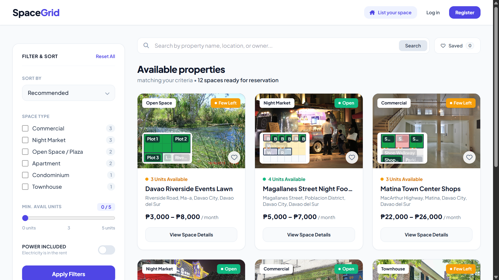
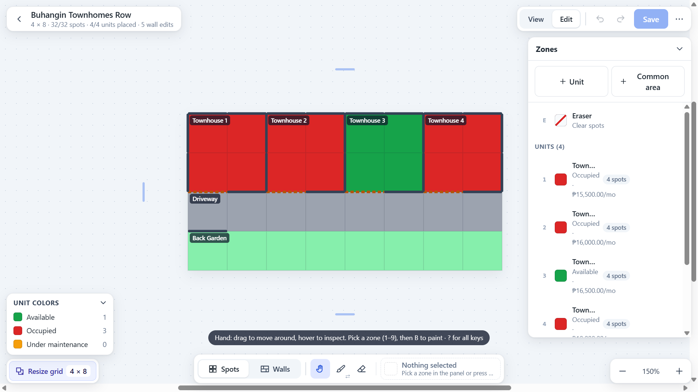
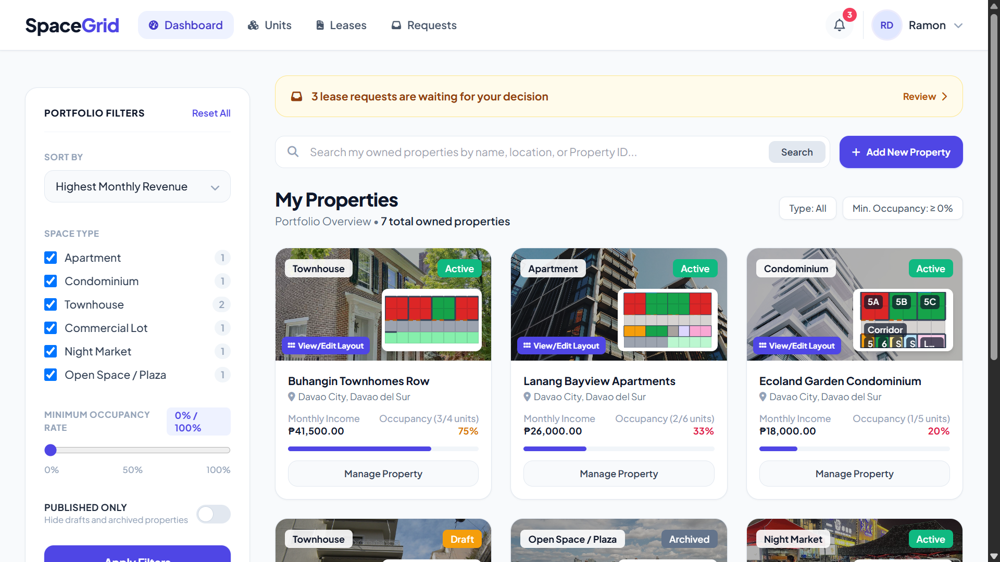
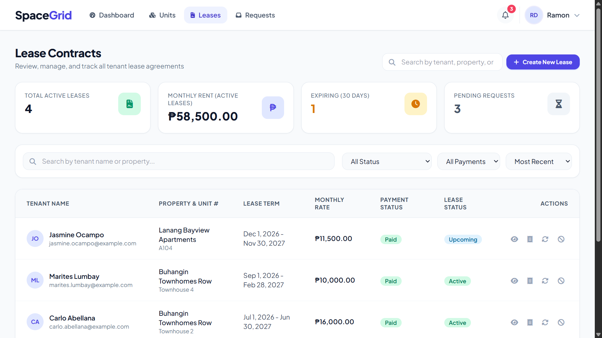
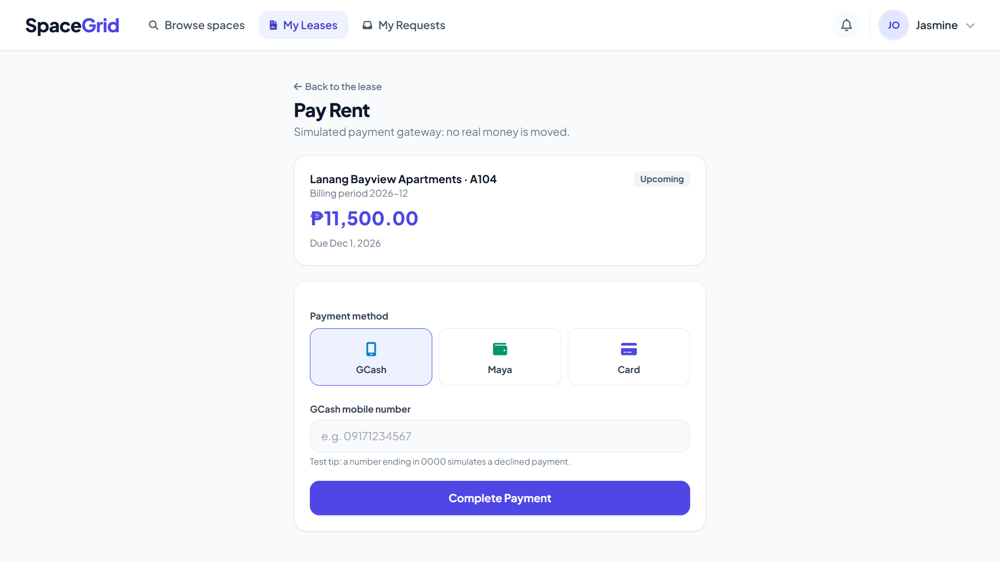
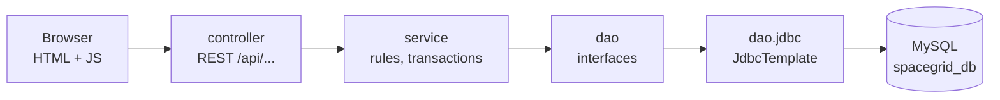

# SpaceGrid

Property rental manager for landlords and renters in Davao City: plot a property on a grid, lease its units and collect rent online.


## Overview

SpaceGrid helps small landlords in Davao City (apartments, condominiums, townhouses, commercial spaces, night
markets and open spaces) keep their rental properties in one place. A landlord draws a property on a grid
(units, walkways, bathrooms, parking and so on), sets a rate for each unit, and manages the leases. A renter
can browse the free units on a public homepage, send a lease request, and pay the monthly rent.

The problem it solves: rental details usually live in notebooks and chat threads. SpaceGrid keeps the layout,
the tenants, the lease dates and the payments together, so both sides can see what is occupied, what is due and
what is overdue. Payments are **simulated** (there is no real payment provider).

SpaceGrid is an Object-Oriented Programming final project. It was first written as a Java Swing desktop app and
was converted to a web frontend (plain HTML, CSS and JavaScript) served by Spring Boot.

## Table of contents

1. [Screenshots](#screenshots)
2. [Features](#features)
3. [Tech stack](#tech-stack)
4. [Architecture](#architecture)
5. [Project structure](#project-structure)
6. [Database](#database)
7. [Getting started](#getting-started)
8. [Configuration](#configuration)
9. [Demo accounts](#demo-accounts)
10. [API overview](#api-overview)
11. [Testing](#testing)
12. [Project status and roadmap](#project-status-and-roadmap)
13. [Documentation](#documentation)
14. [Contributing](#contributing)
15. [Team](#team)
16. [Credits and acknowledgments](#credits-and-acknowledgments)
17. [License](#license)

## Screenshots

Taken with the demo data (accounts `landlord` and `renter`, see [Demo accounts](#demo-accounts)).

**Public homepage**



**Grid plotter (landlord)**



**Landlord dashboard**



**Lease page with the payment statement**



**Renter pay page**



## Features

"Available" means the code and the page exist and work with the database. "Planned" means it is not built yet.

### Public (homepage, no login)

| Feature | Status |
|---|---|
| Browse every ACTIVE property that has a free unit | Available |
| Search, filters, sorting and pagination (in the browser) | Available |
| Details window with the layout preview and the free units | Available |
| Saved spaces (kept in the browser only) | Available |

### Landlord

| Feature | Status |
|---|---|
| Register and log in | Available |
| Create, edit, publish and archive properties (address, type, amenities, default rate) | Available |
| Grid plotter: units, common areas, walls/doors/windows, undo/redo, View and Edit modes (up to 60 × 60) | Available |
| Unit list with quick edit, maintenance status, archive or delete | Available |
| Photos and site plans for properties, photos for units, contract PDFs for leases | Available |
| Create, renew, end and terminate leases; confirm the move-out | Available |
| Approve or decline lease requests | Available |
| Payment statement per lease (overdue / due / paid) | Available |
| Dashboard notifications (bell in the top bar) | Available |
| Lease timing markers on the plotter | Planned |
| Map pin on the property form (placeholder only, nothing is saved) | Planned |

### Renter

| Feature | Status |
|---|---|
| Register and log in; add e-mail and phone | Available |
| Send, follow and cancel lease requests | Available |
| Dashboard with current and past leases | Available |
| Pay rent with GCash, Maya or card (simulated), oldest period first, paying ahead allowed | Available |
| Payment history and receipts | Available |
| E-mail or SMS notifications | Planned |

## Tech stack

| Layer | Technology | Version | Purpose |
|---|---|---|---|
| Language | Java | 17 (`java.version` in `pom.xml`) | The whole backend |
| Framework | Spring Boot (`spring-boot-starter-webmvc`) | 4.1.1 | REST API, embedded Tomcat, serves the static pages |
| Build | Maven | 3.9+ (use the one in NetBeans or your own) | Build and run |
| Data access | Spring `JdbcTemplate` (`spring-boot-starter-jdbc`) | managed by Spring Boot 4.1.1 | Hand-written SQL in the DAO classes |
| Database | MySQL / MariaDB (XAMPP), `mysql-connector-j` | managed by Spring Boot 4.1.1 | Data storage |
| Passwords | jBCrypt | 0.4 | Password hashing |
| Frontend | HTML, CSS, JavaScript | plain | Pages in `src/main/resources/static` |
| Styling | Tailwind CSS (CDN) and Font Awesome 6.4.0 (CDN) | CDN | Look of the pages (needs internet) |
| Dev tools | `spring-boot-devtools`, `spring-boot-starter-test` | managed by Spring Boot 4.1.1 | Restart on change; JUnit 5 |

There is no JPA/Hibernate and no frontend framework or build step.

## Architecture

The browser calls a REST controller. The controller hands the work to a service, which checks the business rules
and calls DAO interfaces. The JDBC classes behind them run the SQL against MySQL. The logged-in user always comes
from the session, never from the browser.



| Package (`com.techhub.spacegridapplication`) | What it does |
|---|---|
| `model` | Entities, enums and value objects (Java records). No SQL and no web code. |
| `controller` | `@RestController` classes under `/api/...`. |
| `service` | Business rules; `@Transactional` on writes that touch several tables. Includes `LeaseExpiryJob`. |
| `dao` | One interface per entity (`CrudDao<T>` is the base). |
| `dao.jdbc` | The JdbcTemplate implementations of the DAO interfaces. |
| `security` | `PasswordHasher` / `BCryptPasswordHasher` and `SessionManager` (login session). |
| `payment` | `PaymentGateway` and `FakePaymentGateway` (simulated payments). |
| `exception` | `SpaceGridException` and its subclasses, `GlobalExceptionHandler` (errors as `{"error": "..."}`). |
| `config` | `WebConfig`: page routes such as `/`, `/login`, `/register`, `/requests`. |

## Project structure

```text
SpaceGridApplication/
├── CLAUDE.md                     Notes for the AI assistant: rules, conventions, status
├── README.md                     This file
├── pom.xml                       Maven build (Spring Boot 4.1.1, Java 17)
├── database/
│   └── spacegrid_db.sql          Schema + sample data (drops and recreates spacegrid_db)
├── docs/
│   ├── instructions.md           Step-by-step setup guide and troubleshooting
│   └── projectfiles/             Specs, ERD, UML diagrams, design log, manuscript
└── src/
    ├── main/
    │   ├── java/com/techhub/spacegridapplication/
    │   │   ├── config/           Page routes
    │   │   ├── controller/       REST controllers
    │   │   ├── dao/              DAO interfaces (+ jdbc/ implementations)
    │   │   ├── exception/        Error classes and handler
    │   │   ├── model/            Entities, enums, value objects (and DemoImages)
    │   │   ├── payment/          Simulated payment gateway
    │   │   ├── security/         Password hashing, session
    │   │   ├── service/          Business rules
    │   │   └── SpaceGridApplication.java   Entry point
    │   └── resources/
    │       ├── application.properties      Settings
    │       └── static/                     The web pages
    │           ├── homepage.html, login.html, register.html, requests.html, lease.html
    │           ├── landlord/    Dashboard, units, leases, forms, grid plotter
    │           ├── renter/      Dashboard and pay page
    │           ├── css/         Shared styles
    │           ├── js/          common/ helpers and pages/ scripts
    │           └── images/      zones/ (grid images), properties/ and units/ (demo photos)
    └── test/java/                Test classes (not written yet)
```

`target/` (build output), `uploads/` (uploaded files, created when the app runs) and `incoming-images/` (photos before sorting) are not in git. The demo photos are in `src/main/resources/static/images/properties/` and `units/`: a property or unit with no uploaded photo shows the demo photo whose file name starts with its id (`property-06-...-cover.jpg`, `unit-021-...-01.jpg`).

## Database

`spacegrid_db` has 11 tables and 2 views. The full schema is in [database/spacegrid_db.sql](database/spacegrid_db.sql)
and the diagram is [docs/projectfiles/SpaceGrid-Phase2-ERD.drawio](docs/projectfiles/SpaceGrid-Phase2-ERD.drawio)
(PNG: [docs/projectfiles/diagrams/erd-spacegrid-db.png](docs/projectfiles/diagrams/erd-spacegrid-db.png)).

| Table / view | Purpose |
|---|---|
| `users` | Landlord and renter accounts |
| `properties` | A property: address, type, status, grid size, amenities |
| `grid_zones` | Every zone on a property's grid (a unit or a common area) |
| `rentable_units` | The unit part of a zone: rate, status, size, utilities |
| `common_areas` | The common-area part of a zone: type and color |
| `zone_cells` | Which grid spot belongs to which zone |
| `edge_overrides` | Manual walls, doors, windows and openings between spots |
| `lease_contracts` | Leases, including renewal links and the closing information |
| `payments` | Rent payments and their reference numbers |
| `uploaded_files` | Records of photos, site plans and contract PDFs |
| `lease_requests` | A renter's request for a unit |
| `lease_details` (view) | A lease with unit, property and renter names |
| `lease_request_details` (view) | A request with unit, property and renter names |

**The script drops and recreates `spacegrid_db`.** Run it again to reset the data.

## Getting started

Prerequisites: JDK 17 or newer, XAMPP (MySQL), and Maven or NetBeans. Internet is needed for the first build and
for the pages (Tailwind and Font Awesome come from CDNs).

1. Clone the repository:

   ```bash
   git clone <the-repository-url>
   cd SpaceGridApplication
   ```

2. Start **MySQL** in the XAMPP Control Panel.
3. Create the database and sample data (this deletes any existing `spacegrid_db`). **Recommended: MySQL Workbench.** Open a connection to `localhost` (user `root`, no password), choose *File > Open SQL Script...*, select `database/spacegrid_db.sql` and click the lightning icon (*Execute*).

   Alternative without Workbench (command line):

   ```bash
   C:\xampp\mysql\bin\mysql.exe -u root < database/spacegrid_db.sql
   ```

   macOS/Linux: `mysql -u root < database/spacegrid_db.sql`. phpMyAdmin's Import tab also works (see [docs/instructions.md](docs/instructions.md)).
4. Check `src/main/resources/application.properties` (default: `localhost:3306`, user `root`, no password).
5. Run the app (or use NetBeans: Clean and Build, then Run):

   ```bash
   mvn spring-boot:run
   ```

Open <http://localhost:8080/> for the homepage and <http://localhost:8080/login> to log in.
More detail and troubleshooting: [docs/instructions.md](docs/instructions.md).

## Configuration

Settings in `src/main/resources/application.properties` that you might change. Any of them can also be set
with an environment variable, for example `SPRING_DATASOURCE_URL` or `SERVER_PORT`.

| Setting | Default | Meaning |
|---|---|---|
| `server.port` | `8080` | Port of the web server |
| `spring.datasource.url` | `jdbc:mysql://localhost:3306/spacegrid_db?serverTimezone=Asia/Manila&characterEncoding=UTF-8` | Database address (change the port if XAMPP uses another) |
| `spring.datasource.username` | `root` | Database user |
| `spring.datasource.password` | *(empty)* | Database password |
| `spring.sql.init.mode` | `never` | The SQL script is never run automatically |
| `server.servlet.session.timeout` | `30m` | Login session length |
| `spacegrid.upload-dir` | `uploads` | Folder for uploaded files (not in git) |
| `spring.servlet.multipart.max-file-size` | `10MB` | Largest upload |
| `logging.level.com.techhub.spacegridapplication` | `DEBUG` | Log detail of the app's own classes |

## Demo accounts

All passwords are `password123`. Today in the demo story is **2026-10-29**; the dates, states (UPCOMING, DUE, OVERDUE...) and payments are fixed for that day. Full plan: [dummy-data-plan.md](docs/projectfiles/dummy-data-plan.md).

| Username | Role | What it demonstrates |
|---|---|---|
| `landlord` | Landlord | The fullest account: 7 properties (all six types; ACTIVE, ARCHIVED, DRAFT), every unit status, leases in several states, a lease waiting for its move-out, overdue rent |
| `landlord2` | Landlord | A smaller mix (commercial, night market, open space); an auto-ended lease waiting for its move-out; an approved request that still needs a lease |
| `landlord3` | Landlord | Almost new: one DRAFT property with an unfinished grid, no leases (empty state) |
| `renter` | Renter | The fullest renter: leases in every state, three landlords, all four request statuses |
| `renter2` | Renter | Two ACTIVE leases with different landlords; quarterly and arrears payment terms; paid ahead; overdue |
| `renter3` | Renter | A renewal chain of three leases, a TERMINATED lease and an auto-ended one, both waiting for the move-out |
| `renter4` | Renter | No leases, only PENDING and DECLINED requests |
| `renter5` | Renter | Brand new, nothing at all, no e-mail or phone (empty state; cannot send a request yet) |
| `maria.santos` | Landlord | Original sample data: 3 properties, units, leases, payments |
| `jose.reyes` | Landlord | Original sample data: market stalls and a night market |
| `ana.cruz`, `paolo.garcia`, `liza.mendoza` | Renter | Original sample leases, payments and requests |

The `LeaseExpiryJob` runs at startup and ends leases whose end date is before today, so lease 9 (`renter`, Townhouse 1) shows up as automatically ENDED, not EXPIRED.


## API overview

All paths start with `/api`. "Landlord" and "Renter" mean the role is checked; "Logged in" means any role
(the service then checks ownership). Errors come back as `{"error": "..."}`. Details and JSON shapes:
[docs/projectfiles/HOW-TO-CONNECT.md](docs/projectfiles/HOW-TO-CONNECT.md) and
[docs/projectfiles/SpaceGrid-Phase1-Spec.md](docs/projectfiles/SpaceGrid-Phase1-Spec.md). No endpoint is
still a TODO.

**Auth** (`AuthController`)

| Method | URL | Who | Purpose |
|---|---|---|---|
| POST | `/api/auth/register` | Anyone | Create an account and log in |
| POST | `/api/auth/login` | Anyone | Log in |
| POST | `/api/auth/logout` | Anyone | Log out |
| GET | `/api/auth/me` | Logged in | The current user (401 if not) |
| PUT | `/api/auth/me/contact` | Logged in | Save e-mail and phone |

**Browse** (`BrowseController`)

| Method | URL | Who | Purpose |
|---|---|---|---|
| GET | `/api/browse` | Anyone | ACTIVE properties with free units |
| GET | `/api/browse/{id}` | Anyone | One listing with its free units |
| GET | `/api/browse/{id}/layout` | Anyone | The grid layout for the preview |

**Properties** (`PropertyController`)

| Method | URL | Who | Purpose |
|---|---|---|---|
| GET | `/api/properties` | Landlord | My properties |
| GET | `/api/properties/{id}` | Landlord | One property with its grid |
| POST | `/api/properties` | Landlord | Create (DRAFT) |
| PUT | `/api/properties/{id}` | Landlord | Edit details |
| POST | `/api/properties/{id}/publish` | Landlord | DRAFT to ACTIVE |
| POST | `/api/properties/{id}/archive` | Landlord | Archive |
| PUT | `/api/properties/{id}/grid` | Landlord | Save grid size and spots |
| PUT | `/api/properties/{id}/edges` | Landlord | Save walls, doors, windows |

**Units and common areas** (`RentableUnitController`, `CommonAreaController`)

| Method | URL | Who | Purpose |
|---|---|---|---|
| GET / POST | `/api/properties/{propertyId}/units` | Landlord | List / add units |
| PUT | `/api/units/{id}` | Landlord | Edit a unit |
| POST | `/api/units/{id}/maintenance` | Landlord | Toggle maintenance |
| GET | `/api/units/{id}/details` | Landlord | Unit, current lease, open requests |
| GET | `/api/units/{id}/removal-check` | Landlord | Can it be deleted or archived? |
| POST | `/api/units/{id}/archive` | Landlord | Archive a unit |
| DELETE | `/api/units/{id}` | Landlord | Delete a unit |
| GET / POST | `/api/properties/{propertyId}/common-areas` | Landlord | List / add common areas |
| PUT | `/api/properties/{propertyId}/common-areas/{areaId}/color` | Landlord | Set the color |
| PUT / DELETE | `/api/common-areas/{id}` | Landlord | Edit / delete a common area |

**Leases and payments** (`LeaseController`, `PaymentController`)

| Method | URL | Who | Purpose |
|---|---|---|---|
| GET | `/api/leases` | Logged in | My leases (landlord: all of mine; renter: my own) |
| GET | `/api/leases/{id}` | Logged in | One lease |
| GET | `/api/leases/{id}/property` | Logged in | The lease's property |
| GET | `/api/properties/{propertyId}/leases` | Landlord | Leases of a property |
| GET | `/api/renters` | Landlord | Search renter accounts |
| POST | `/api/leases` | Landlord | Create a lease |
| POST | `/api/leases/{id}/renew` | Landlord | Renew |
| POST | `/api/leases/{id}/end` | Landlord | End (from the end date) |
| POST | `/api/leases/{id}/terminate` | Landlord | Terminate with a reason |
| POST | `/api/leases/{id}/move-out` | Landlord | Confirm the move-out |
| GET | `/api/leases/{leaseId}/statement` | Logged in | Billing periods and due status |
| GET | `/api/leases/{leaseId}/payments` | Logged in | Payment history |
| POST | `/api/leases/{leaseId}/payments` | Renter | Pay a period (simulated) |

**Lease requests** (`LeaseRequestController`)

| Method | URL | Who | Purpose |
|---|---|---|---|
| GET | `/api/lease-requests` | Logged in | My requests (landlord: for my properties) |
| POST | `/api/lease-requests` | Renter | Send a request |
| POST | `/api/lease-requests/{id}/approve` | Landlord | Approve |
| POST | `/api/lease-requests/{id}/decline` | Landlord | Decline |
| POST | `/api/lease-requests/{id}/cancel` | Renter | Cancel a PENDING request |

**Files** (`FileController`)

| Method | URL | Who | Purpose |
|---|---|---|---|
| POST / GET | `/api/properties/{propertyId}/files` | Landlord / anyone* | Upload / list property files |
| POST / GET | `/api/units/{unitId}/files` | Landlord / anyone* | Upload / list unit photos |
| POST / GET | `/api/leases/{leaseId}/files` | Landlord / Logged in | Upload / list the contract PDF |
| GET | `/api/files/{id}` | Anyone* | Download a file |
| DELETE | `/api/files/{id}` | Landlord | Delete a file |

\* Property and unit photos are public once the property is ACTIVE; site plans are for the landlord only; a contract is for the landlord and the lease's renter.

## Testing

The project has three test classes (`PropertyTest`, `LeaseContractTest`, `SpaceGridApplicationTests`) under
`src/test/java`. All three are marked `@Disabled` and the model tests contain only TODO comments, so **there are no
real automated tests yet**. Run them with:

```bash
mvn test
```

Until then the app is tested by hand: log in with the demo accounts and try each page.

## Project status and roadmap

**Done**
- [x] Grid model rules, property save/load, plotter with View and Edit modes
- [x] Register, login, sessions, error handling
- [x] Properties: create, edit, publish, archive
- [x] Units and common areas: add, edit, archive, delete
- [x] Leases: create, renew, end, terminate, auto-expiry, move-out confirmation
- [x] Payments: statement, pay (simulated), history
- [x] Public homepage and lease requests
- [x] Photo, site-plan and contract uploads
- [x] UML diagrams and the final project document

**Planned**
- [ ] Lease timing markers on the plotter
- [ ] Map pin on the property form
- [ ] Unit tests (`PropertyTest`, `LeaseContractTest`, `SpaceGridApplicationTests`)
- [ ] "Commercial-ready" flags and business / food permit uploads with landlord review (proposed in [DESIGN-CHANGES.md](docs/projectfiles/DESIGN-CHANGES.md), not built)
- [ ] E-mail or SMS notifications
- [ ] A way to handle a renter who stays after the lease ended (today the landlord confirms the move-out or leases again)

## Documentation

- [docs/instructions.md](docs/instructions.md): setup guide and troubleshooting
- [docs/projectfiles/SpaceGrid-Phase1-Spec.md](docs/projectfiles/SpaceGrid-Phase1-Spec.md): classes, fields, methods and endpoints
- [docs/projectfiles/SpaceGrid-Phase2-ERD.drawio](docs/projectfiles/SpaceGrid-Phase2-ERD.drawio): database diagram
- [docs/projectfiles/SpaceGrid-Phase3-FileStructure.md](docs/projectfiles/SpaceGrid-Phase3-FileStructure.md): the pages and their endpoints
- [docs/projectfiles/SpaceGrid-UML-Diagrams.drawio](docs/projectfiles/SpaceGrid-UML-Diagrams.drawio): package, class and sequence diagrams (PNG copies in [docs/projectfiles/diagrams/](docs/projectfiles/diagrams/))
- [docs/projectfiles/HOW-TO-CONNECT.md](docs/projectfiles/HOW-TO-CONNECT.md): how the pages call the controllers
- [docs/projectfiles/DESIGN-CHANGES.md](docs/projectfiles/DESIGN-CHANGES.md): log of design changes
- [docs/projectfiles/SpaceGrid_Final_Project_Document.docx](docs/projectfiles/SpaceGrid_Final_Project_Document.docx): the project manuscript
- [CLAUDE.md](CLAUDE.md): conventions and business rules in short form

## Contributing

- One branch per feature or fix (for example `feature/lease-markers`, `fix/payment-rounding`, `docs/readme`). Do not commit to `main` directly.
- Commit messages: a short sentence in the imperative ("Add move-out confirmation"). One logical change per commit.
- If you change the design (a class, a table or an endpoint), write a dated entry in [docs/projectfiles/DESIGN-CHANGES.md](docs/projectfiles/DESIGN-CHANGES.md) and update the docs that mention it.
- Do not commit local settings, `uploads/` or `target/`.

## Team

| Name | Role |
|---|---|
| Kit Jasper Caballero | Project Manager |
| Jun Mari Manla | Main Developer |
| Ethan Gabriele Delos Santos | Front End Developer |
| Christian Reynz Agosto | Front End Developer |

## Credits and acknowledgments

Photo credits: [docs/projectfiles/image-credits.md](docs/projectfiles/image-credits.md) (demo photos from Wikimedia Commons, many are stand-ins for the real place).

Third-party libraries and services:

- [Spring Boot](https://spring.io/projects/spring-boot) (Spring Web MVC, Spring JDBC)
- [MySQL Connector/J](https://dev.mysql.com/downloads/connector/j/) and [XAMPP](https://www.apachefriends.org/) (MariaDB)
- [jBCrypt](https://www.mindrot.org/projects/jBCrypt/)
- [Tailwind CSS](https://tailwindcss.com/) through its CDN (`cdn.tailwindcss.com`)
- [Font Awesome](https://fontawesome.com/) 6.4.0 through cdnjs
- Google Fonts: Plus Jakarta Sans

## License

License: to be decided.
